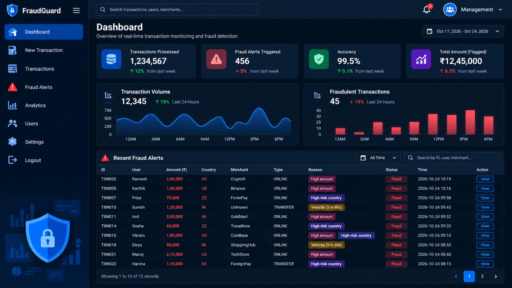
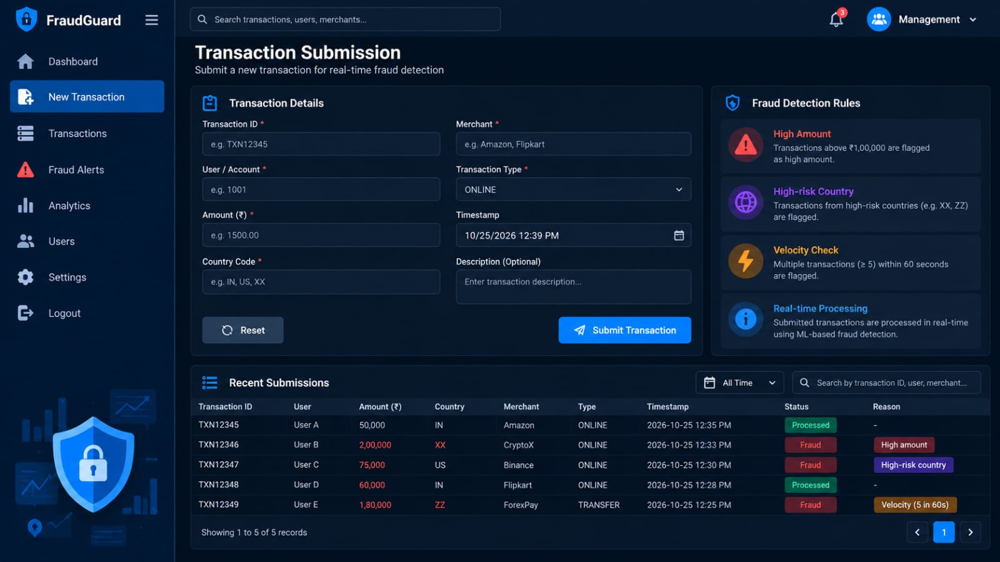
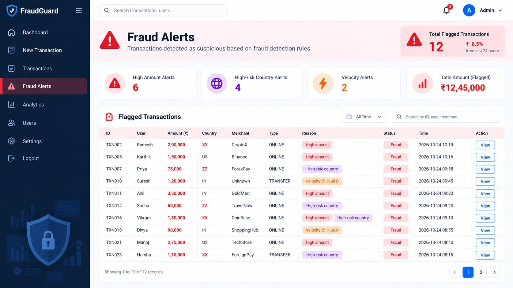

# 🚨 Real-Time Fraud Detection Pipeline

An event-driven **Java full-stack application** for detecting suspicious financial transactions using **Apache Kafka** and rule-based fraud detection.

[](https://www.java.com/)
[](https://spring.io/projects/spring-boot)
[](https://kafka.apache.org/)
[](https://maven.apache.org/)

---

## 🩵 Overview

A full-stack fraud detection demo built with **Java 21, Spring Boot, Apache Kafka, Spring Data JPA, H2 Database, HTML, CSS, and JavaScript**.

The application processes transaction events asynchronously, applies configurable fraud detection rules, stores transaction records, and displays suspicious activity through a web dashboard.

## 🩵 Features

- ⚡ **Real-Time Transaction Processing:** Submit transactions through REST APIs or the web dashboard.
- 🔄 **Event-Driven Architecture:** Publish transaction events to the Kafka topic `transactions`.
- 🛡️ **Fraud Detection Engine:** Identify suspicious transactions using rule-based checks.
- 💾 **Transaction Persistence:** Store records using Spring Data JPA and H2.
- 🚨 **Fraud Alerts:** Retrieve and display flagged transactions.
- 📊 **Interactive Dashboard:** Monitor transaction history and suspicious activity.
- 🌐 **REST APIs:** Submit transactions and retrieve transactions and alerts.
- 🐳 **Docker Compose:** Run Kafka locally.

## 🩵 Technology Stack

| 🌸 **Technology** | 🌸 **Purpose** |
|---|---|
| **Java 21** | Backend development |
| **Spring Boot** | Application framework |
| **Spring Web** | REST API development |
| **Spring Data JPA** | Database persistence |
| **Apache Kafka** | Asynchronous event streaming |
| **H2 Database** | Relational database |
| **Maven** | Build and dependency management |
| **HTML5, CSS3, JavaScript** | Frontend dashboard |
| **Docker Compose** | Local Kafka infrastructure |

## 🩵 System Architecture

```text
┌─────────────────────────────┐
│     Web Dashboard / API     │
└──────────────┬──────────────┘
               │
               ▼
┌─────────────────────────────┐
│    Spring Boot REST API     │
└──────────────┬──────────────┘
               │
               ▼
┌─────────────────────────────┐
│       Kafka Producer        │
└──────────────┬──────────────┘
               │
               ▼
┌─────────────────────────────┐
│ Kafka Topic: transactions   │
└──────────────┬──────────────┘
               │
               ▼
┌─────────────────────────────┐
│       Kafka Consumer        │
└──────────────┬──────────────┘
               │
               ▼
┌─────────────────────────────┐
│     Fraud Rule Engine       │
└──────────────┬──────────────┘
               │
               ▼
┌─────────────────────────────┐
│  Spring Data JPA + H2       │
└──────────────┬──────────────┘
               │
               ▼
┌─────────────────────────────┐
│  Transactions and Alerts    │
└─────────────────────────────┘
```

## 🩵 Screenshots & Expected Output

The following screenshots showcase the main features of the Real-Time Fraud Detection Pipeline.

### 🌸 1. Application Dashboard

Displays recent transactions, transaction details, and fraud detection status.




### 🌸 2. Transaction Submission

Shows the transaction submission interface for entering customer details, transaction amount, currency, merchant, and country.



### 🌸 3. Fraud Detection Alerts

Displays suspicious transactions flagged by the rule-based fraud detection engine.



> **Note:** Upload the corresponding image files to the `screenshots/` folder. These images will appear once the paths and filenames match.

## 🩵 Fraud Detection Rules

The demo uses three rule-based checks to identify potentially suspicious transactions.

| 🌸 **Rule** | 🌸 **Condition** | 🌸 **Expected Result** |
|---|---|---|
| **High-Amount Transaction** | Amount ≥ `10000` | Flag transaction |
| **High-Risk Country** | Country code is `XX` | Flag transaction |
| **Transaction Burst** | Three transactions from the same customer within two minutes | Flag suspicious activity |

*These rules are intended for demonstration purposes and are not production-grade financial fraud policies.*

## 🩵 Prerequisites

Install the following tools before running the project:

- **Java JDK 21+:** [Download](https://adoptium.net/)
- **Apache Maven 3.9+:** [Download](https://maven.apache.org/download.cgi)
- **Docker Desktop:** [Download](https://www.docker.com/products/docker-desktop/)
- **Git:** [Download](https://git-scm.com/downloads)

### Verify Your Installations

```bash
java -version
mvn -version
docker --version
docker compose version
```

## 🩵 Getting Started

### 1. Clone the Repository

Clone the repository using the following commands:

```bash
git clone https://github.com/phaneendrak-gif/real-time-fraud-detection-using-java-full-stack.git
cd real-time-fraud-detection-using-java-full-stack
```

### 2. Start Kafka

Ensure Docker Desktop is running.

```bash
docker compose up -d
```

Verify the containers:

```bash
docker compose ps
```

The application is expected to connect to Kafka at:

```text
localhost:9092
```

### 3. Start the Spring Boot Application

Run this command from the directory containing `pom.xml`:

```bash
mvn spring-boot:run
```

Alternatively, build and run the packaged application:

```bash
mvn clean package
java -jar target/*.jar
```

### 4. Open the Dashboard

Open your browser and navigate to:

**http://localhost:8080**

Submit transactions and review transaction records and fraud alerts.

### 5. Stop Kafka

```bash
docker compose down
```

## 🩵 REST API Documentation

**Base URL:** `http://localhost:8080`

### 1. Submit a Transaction

**Endpoint:** `POST /api/transactions`

```bash
curl -X POST http://localhost:8080/api/transactions \
  -H "Content-Type: application/json" \
  -d '{
    "customerId": "C100",
    "amount": 15000,
    "currency": "INR",
    "merchant": "Electronics Store",
    "country": "IN"
  }'
```

**Expected behavior:** The transaction meets the high-amount rule and should be flagged after the Kafka consumer processes the event.

### 2. Retrieve Transactions

**Endpoint:** `GET /api/transactions`

```bash
curl http://localhost:8080/api/transactions
```

Returns transaction records according to the application's implementation.

### 3. Retrieve Fraud Alerts

**Endpoint:** `GET /api/alerts`

```bash
curl http://localhost:8080/api/alerts
```

Returns transactions flagged by the fraud detection engine.

> **Note:** Kafka processing is asynchronous, so a newly submitted transaction may take a short time to appear in the results.

## 🩵 Testing the Fraud Rules

### 🌸 Test 1: High-Amount Transaction

Submit a transaction with an amount of `15000`.

**Expected result:** The high-amount rule flags the transaction.

### 🌸 Test 2: High-Risk Country

Submit a transaction with country code `XX`.

**Expected result:** The high-risk-country rule flags the transaction.

### 🌸 Test 3: Transaction Burst

Submit three transactions for customer `C100` within two minutes.

**Expected result:** The burst rule flags suspicious activity if the configured condition is satisfied.

## 🩵 Project Structure

```text
real-time-fraud-detection/
├── src/
│   ├── main/
│   │   ├── java/
│   │   │   └── com/example/fraud/
│   │   │       ├── controller/
│   │   │       ├── service/
│   │   │       ├── repository/
│   │   │       ├── model/
│   │   │       ├── dto/
│   │   │       ├── config/
│   │   │       └── FraudDetectionApplication.java
│   │   └── resources/
│   │       ├── static/
│   │       └── application.properties
│   └── test/
├── screenshots/
│   ├── dashboard.png
│   ├── transaction-submission.png
│   └── fraud-alerts.png
├── docker-compose.yml
├── pom.xml
├── .gitignore
└── README.md
```

*The structure is illustrative. Update it to match your actual source files and package names.*

## 🩵 Configuration

Check `src/main/resources/application.properties` for your actual Kafka and database configuration.

Example settings:

```properties
spring.kafka.bootstrap-servers=localhost:9092
spring.datasource.url=jdbc:h2:file:./data/frauddb
spring.jpa.hibernate.ddl-auto=update
```

*These are example values. Keep the settings consistent with your implementation.*

## 🩵 Future Enhancements

- 🔐 **JWT Authentication:** Add authentication and role-based authorization.
- 🐘 **PostgreSQL Integration:** Use PostgreSQL for persistent relational storage.
- 🎯 **Configurable Fraud Rules:** Add configurable rules and risk scoring.
- 🔁 **Idempotent Processing:** Prevent duplicate transaction processing.
- 📬 **Kafka Error Handling:** Add retry handling and dead-letter topics.
- 🧪 **Automated Testing:** Use JUnit and Testcontainers for unit and integration tests.
- 📈 **Monitoring:** Add Spring Boot Actuator and Micrometer.
- 🚀 **CI/CD Automation:** Integrate GitHub Actions.
- 🤖 **Machine Learning:** Add ML-based fraud scoring and anomaly detection.

## 🩵 Security Disclaimer

This project is intended for **educational purposes, portfolio demonstrations, and local development**. It is not a production-ready financial fraud prevention system.

Production deployment requires appropriate authentication, authorization, secure secret management, input validation, reliable event processing, audit logging, and comprehensive testing.

## 🩵 Author

**Katta Phaneendra**

*Java Full Stack Developer | Spring Boot | Apache Kafka | REST APIs | SQL*

- **GitHub:** https://github.com/phaneendrak-gif
- **LinkedIn:** https://www.linkedin.com/in/phaneendra1345/


## 🩵 License

## 🩵 License

This project is licensed under the MIT License. See the [LICENSE] file for details.
